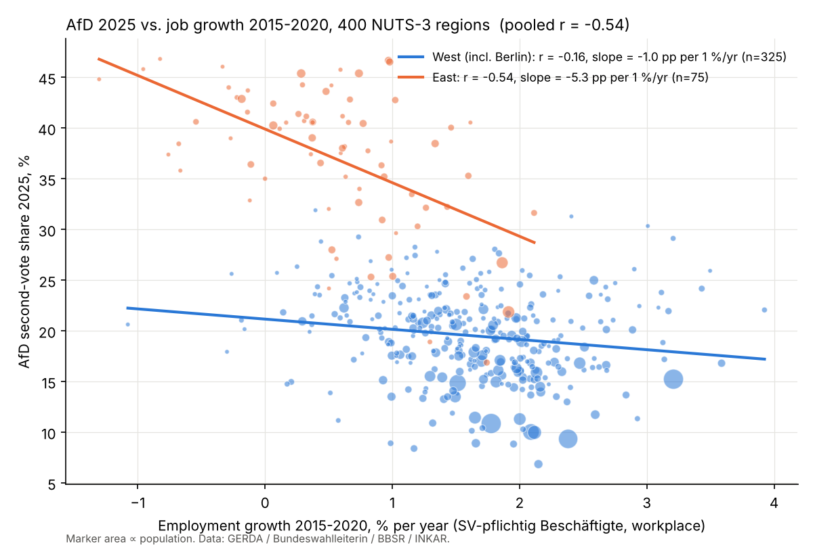
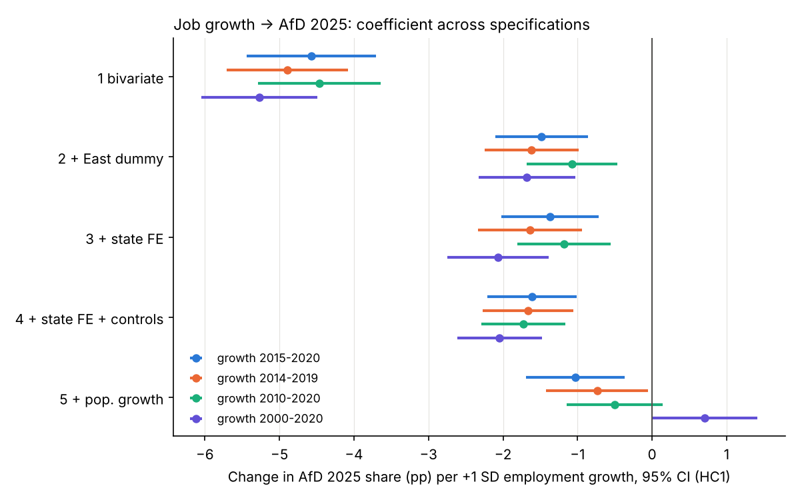

# AfD vote share vs. regional job growth (German NUTS-3 regions)

Do German regions with weaker employment growth vote more for the AfD? This repo correlates
AfD **Bundestag second-vote shares (2017, 2021, 2025)** with **employment growth** across all
**400 Kreise / kreisfreie Städte**. On 2021 boundaries these are the same 400 units as the
EU's **NUTS-3** regions for Germany (NUTS 2021).

```bash
pip install -r requirements.txt
scripts/download_data.sh     # fetches the inputs into data/raw/
python3 scripts/analysis.py  # writes results/
```

## Data

| Variable | Source (via [GERDA](https://github.com/awiedem/german_election_data), harmonised to 2021 boundaries) |
|---|---|
| AfD second-vote share by county, 2013–2025 | Bundeswahlleiterin → `federal_cty_harm` |
| Employees subject to social insurance (*sozialversicherungspflichtig Beschäftigte*), 1997–2020 | BBSR → `cty_area_pop_emp` |
| Population, density | BBSR → `cty_area_pop_emp` |
| GDP per capita, foreign-national share (2019) | INKAR → `cty_inkar_harm2021` |

Growth is the **annualised log growth in %** over each window. The employment series stops
in **2020**, so the most recent window is 2015–2020; 2014–2019 is included as a pre-COVID
check. "East" means the five eastern Länder. Berlin is coded West.

Citation: Heddesheimer, Hilbig, Sichart & Wiedemann (2025), *GERDA: The German Election
Database*, Scientific Data 12:618 (CC BY 4.0). INKAR/BBSR data: dl-de/by-2.0.

## Results

### 1. Raw correlations (n = 400)

| AfD share | Job growth window | Pearson r | Spearman ρ | Pop.-weighted r | r within West (n=325) | r within East (n=75) |
|---|---|---|---|---|---|---|
| 2025 | 2015–2020 | **−0.54** | −0.49 | −0.56 | −0.17 (p=.003) | **−0.54** (p<.001) |
| 2025 | 2014–2019 | −0.58 | −0.50 | −0.58 | −0.18 (p=.001) | −0.56 (p<.001) |
| 2025 | 2010–2020 | −0.53 | −0.44 | −0.52 | −0.11 (p=.06) | −0.43 (p<.001) |
| 2025 | 2000–2020 | −0.62 | −0.49 | −0.61 | −0.16 (p=.004) | −0.57 (p<.001) |
| 2021 | 2015–2020 | −0.55 | −0.50 | −0.53 | −0.19 | −0.45 |
| 2017 | 2015–2020 | −0.47 | −0.44 | −0.45 | −0.10 (n.s.) | −0.21 (n.s.) |

Full table: [`results/correlations.csv`](results/correlations.csv).



### 2. Regression of AfD 2025 share on job growth (coefficient = pp change per +1 SD of growth)

One SD of 2015–2020 growth is about 0.85 %/yr. Standard errors are heteroskedasticity-robust (HC1).

| Specification | 2015–2020 | 2010–2020 | 2000–2020 |
|---|---|---|---|
| Bivariate | −4.6 [−5.4, −3.7] | −4.5 | −5.3 |
| + East dummy | −1.5 [−2.1, −0.9] | −1.1 | −1.7 |
| + state fixed effects | −1.4 [−2.0, −0.7] | −1.2 | −2.1 |
| + state FE + density, GDP p.c., foreign share, jobs/resident | −1.6 [−2.2, −1.0] | −1.7 | −2.0 |
| … + population growth over the same window | −1.0 [−1.7, −0.4] | −0.5 (n.s.) | **+0.7** |

Full table: [`results/regressions.csv`](results/regressions.csv).



### 3. Within-county panel (county + election FE; AfD in 2013/2017/2021 vs. job growth in the preceding ~4 years)

| Sample | pp AfD per +1 %/yr job growth | p |
|---|---|---|
| All | −0.65 (SE 0.24) | .007 |
| All, with East-specific election effects | −0.38 (SE 0.13) | .002 |
| West | −0.17 (SE 0.11) | .13 |
| East | −1.26 (SE 0.37) | .001 |

Standard errors are clustered by county. See [`results/panel_fe.csv`](results/panel_fe.csv).

## Interpretation

1. **The raw correlation is strong but mostly reflects East vs. West.** Across all 400 regions,
   r ≈ −0.55. Eastern regions had about 1 %/yr slower job growth and roughly double the AfD
   share (37 % vs. 20 % in 2025). Adding a single East dummy cuts the coefficient by
   about two-thirds.
2. **A real but modest relationship remains within Länder.** With state fixed effects and
   structural controls, a region with 1 SD faster job growth has an AfD share about
   **1.5 pp lower**. That is small next to the 17 pp East–West gap.
3. **The link is much stronger in the East.** Within the East, r ≈ −0.55 and the slope is
   about 5 pp per 1 %/yr of growth. In the West the relationship is weak (r ≈ −0.15,
   about 1 pp per 1 %/yr).
4. **Demographic decline matters more than jobs.** Population growth correlates with AfD 2025
   at r = −0.72 and with job growth at r = 0.6–0.8. Once population growth is controlled for,
   the long-run job-growth effect goes away (it even turns slightly positive). Only recent
   job growth (2015–2020) keeps a small independent effect. Shrinking, ageing regions with
   out-migration vote AfD; job growth is largely a proxy for that.
5. **Within the same county over time, the relationship is weak.** Faster job growth before
   an election goes with a slightly lower AfD share, mainly in the East. The size is small
   (well under 1 pp per 1 %/yr) once eastern regions' general surge after 2017 is accounted for.

These are correlations, not causal estimates. Possible issues: reverse causality (e.g. AfD
strength discouraging in-migration of workers or firms), commuting (jobs are counted at the
workplace, votes at the residence), and the employment series ending in 2020.

## Files

- `scripts/download_data.sh`: downloads the inputs.
- `scripts/analysis.py`: builds the dataset, runs correlations, regressions and the panel, and draws the figures.
- `results/nuts3_afd_employment.csv`: the merged county-level dataset (400 rows: AfD shares, growth rates, controls).
